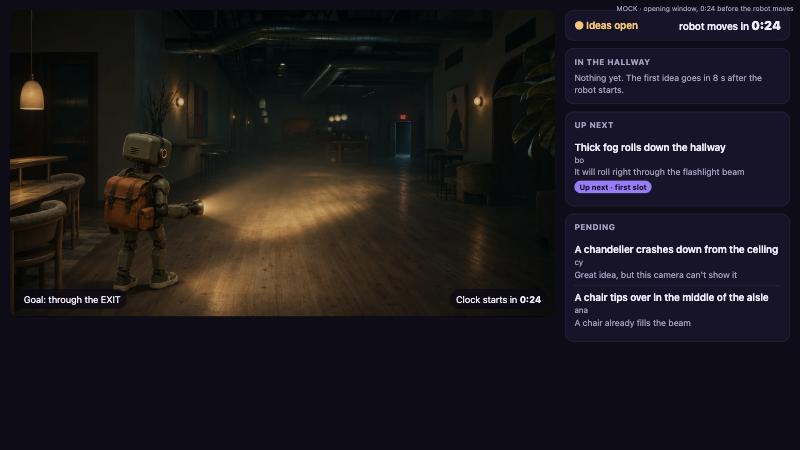
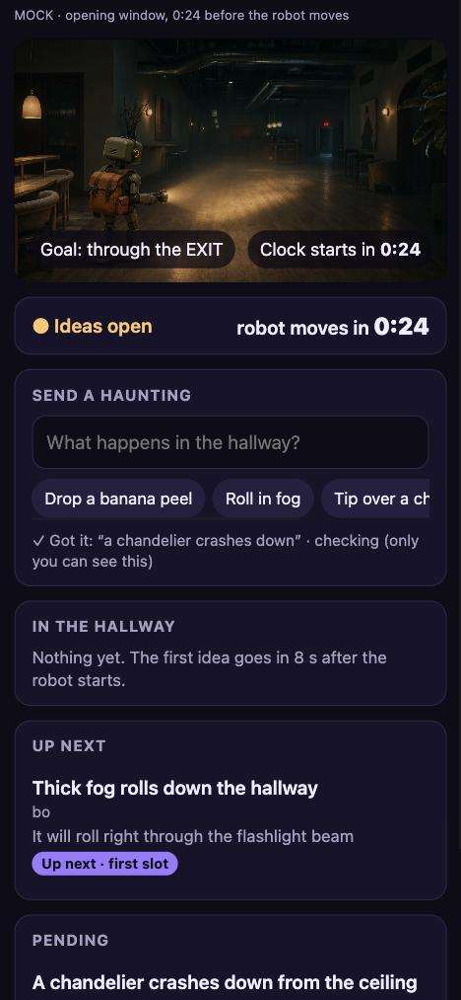
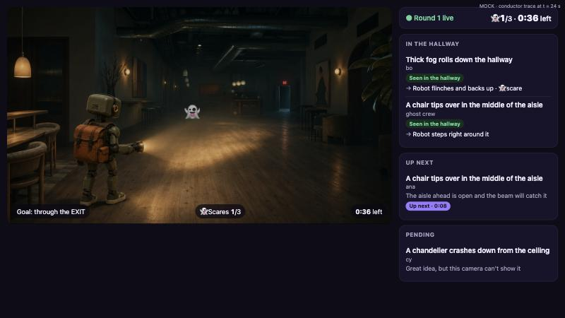
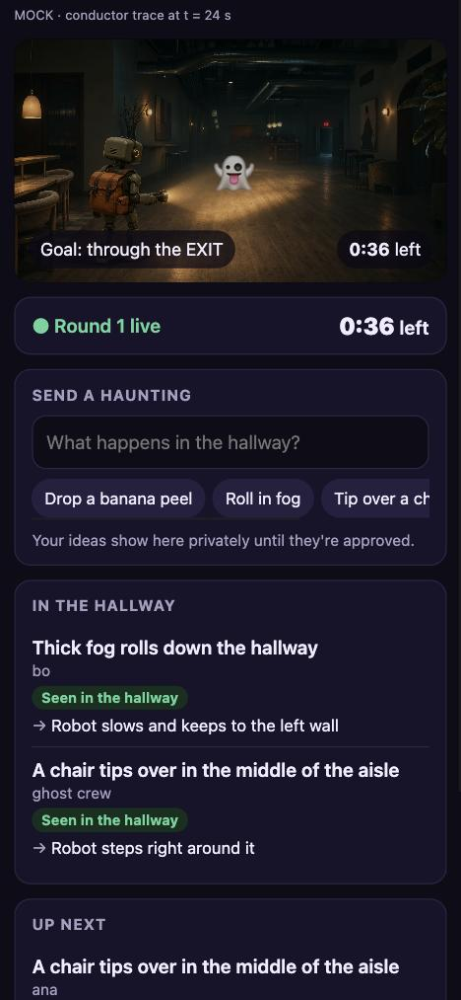
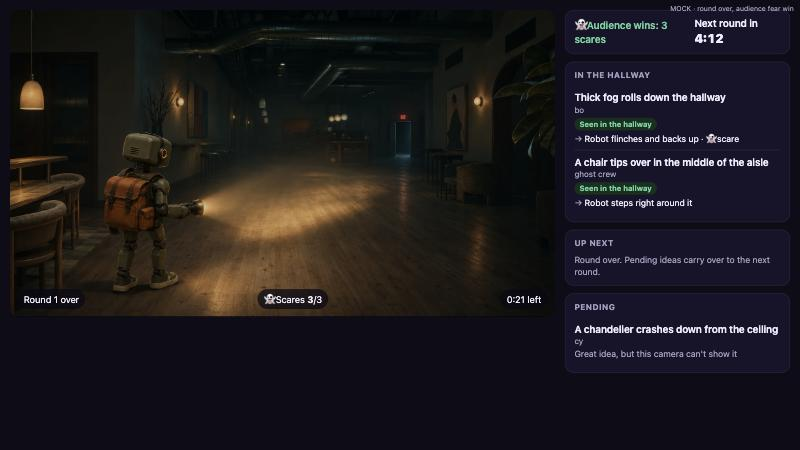
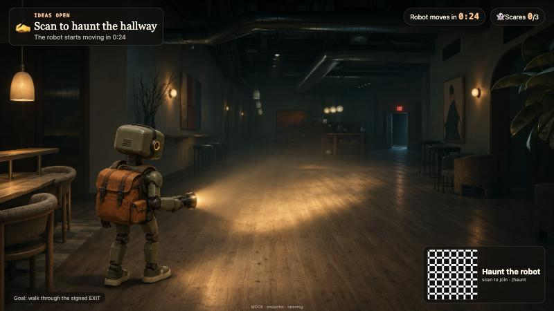
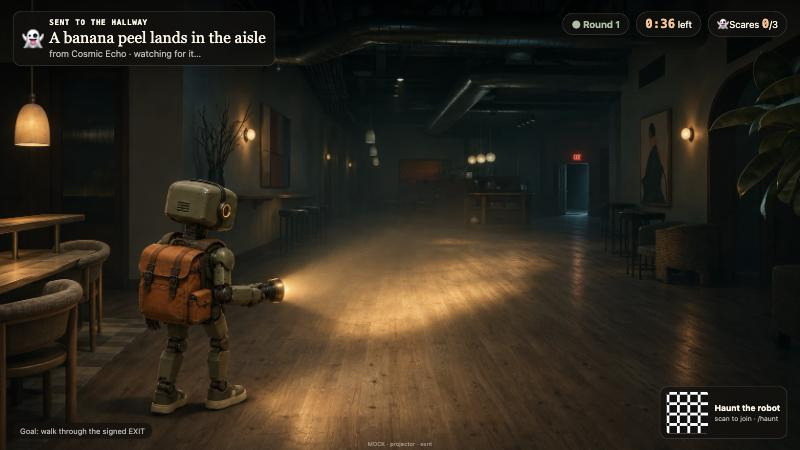
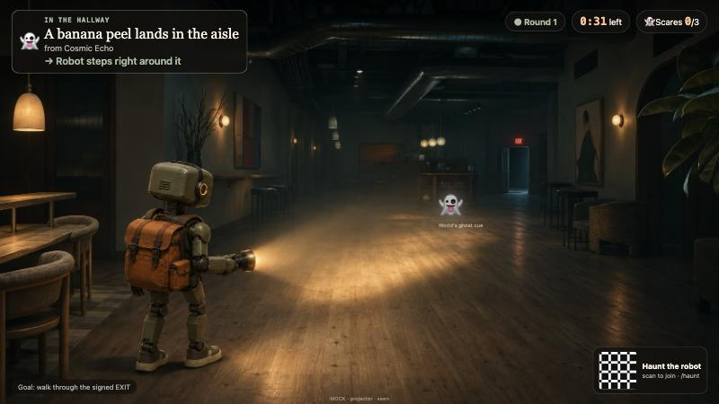
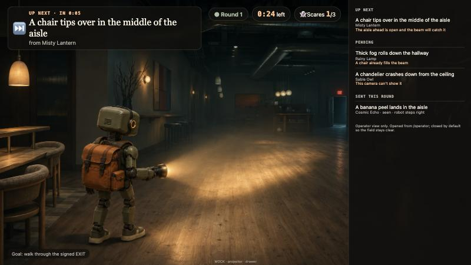
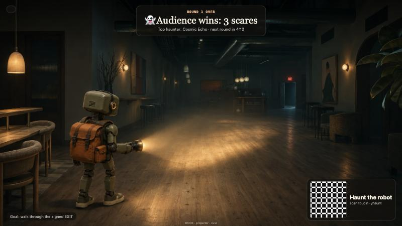

# Audience conductor v0 (wired into the scheduler)

Crowd's answer to World's [conductor brief](../../../FEATURES.md#the-audience-conductor). The policy is code: [`server/conductor.ts`](../server/conductor.ts). The trace below is asserted by [`test/conductor.test.ts`](../test/conductor.test.ts). **It's wired into the live scheduler** ([`server/crowd.ts`](../server/crowd.ts) `reserve()`/`tick()`), reading World's `/rehearsal/state` through [`server/scene.ts`](../server/scene.ts) when `PG_CROWD_SCENE_URL` is set. With no fresh scene it's FIFO, as before.

| | Projector (robot first, feed beside it) | Phone, 390 px (live view, then the same feed below) |
|---|---|---|
| **Opening, 30 s** |  |  |
| **Live, t = 24 s** |  |  |
| **Over: fear win** |  | (same phase bar on the phone) |

## Projector overlay (supersedes the sidebar mocks above)

World's direction (#2): the projector is a full-bleed game view from the trailing camera behind the robot's right shoulder, with the action first. The field ahead of the flashlight stays clear and captions stay at the edge. No heading, host controls or full queue on the field by default. Mock: [`projector-mock.html`](projector-mock.html) (`?state=opening|upnext|sent|seen|drawer|over`), served by `pnpm dev` at `/dev/docs/projector-mock.html`.

| Opening | Up next | Sent to the hallway |
|---|---|---|
|  |  |  |
| **In the hallway** (camera evidence) | **Operator drawer** (opened from /operator) | **Result** |
|  |  |  |

- **One compact card, top-left edge.** It walks one idea through the stages: "Up next · in 0:08" → **"Sent to the hallway"** on `haunt.injected` (watching for it…) → **"In the hallway"** plus the robot's reaction, only with separate camera evidence (`haunt.seen`).
- **Top-right pills:** round, time left and scares. At the **bottom-left**, a small goal line. At the **bottom-right**, the QR code: large during the opening and on the result screen, small during play.
- **Operator drawer:** shows Up next, Pending with the conductor's reasons, and what was sent this round. It's operator-only, closed by default, and the pills shift left so the timer stays visible.
- **The ghost cue is World's,** drawn at the site of the change. Crowd draws nothing in the field.
- Sizes are in `vw`, so the same layout scales from a laptop to a 1080p or 4K projector.

## Round phases (matching on both screens)

| Phase | Phase bar and HUD | Phone | Conductor |
|---|---|---|---|
| **Opening** (30 s before the robot moves) | "● Ideas open · robot moves in 0:24" / "Clock starts in 0:24" | Submit box and presets open; private receipt immediately | Nothing is sent and **nothing is reserved**, so guests can keep changing their waiting idea. The first pick is reserved once the round is playing (Courtney's call with World, 2026-11-21). |
| **Live** | "● Round N live · 0:36 left" | Same, plus "In the hallway" fills in | First slot 8 s after the clock starts, then every 12 s (max 6). |
| **Over** | One of: "Robot escaped" (feet crossed the signed exit) · "Audience wins: 3 scares" (three confirmed startles, one per distinct haunting) · "Audience wins: time's up" · "Interrupted: no winner" | Submissions carry over to the next round | Nothing reserved. |

The HUD and phase bar also show the scare count ("👻 Scares 1/3"). A scare counts only when a startle (flinch, stumble, recovery) is confirmed for a distinct haunting; clean avoidance earns nothing, and ambiguous reactions aren't counted. Three scares is World's playtest rule, not a shared contract yet. Phase timing comes from World's `round.phase { roundId, phase, at, endsAt, episodeId? }`, and both screens count down to the same `endsAt`. Ideas are accepted through play as well as the opening.

The player keeps getting clean right-shoulder frames in every phase. The phase bar, captions and ghost cue are audience-only.

## What the audience sees

| Section | Shows | Who sees it |
|---|---|---|
| (private) | "Checking…", rejections with their reason, "Edit & resubmit" | The author's phone only |
| **Pending** | Approved ideas still available this round, each with a short public reason if the conductor is holding it ("Great idea, but this camera can't show it") | Everyone |
| **Up next** | Exactly one reserved idea, its author's nickname, and a reason people can check against the shot ("The aisle ahead is open and the beam will catch it"), with a countdown to the slot | Everyone |
| **In the hallway** | "Sent to world" on World's delivery ACK, then **"Seen in the hallway"** plus the observed response ("Robot steps right around it") only after World's visual confirmation | Everyone |

Only moderated text, nicknames and fixed or validated reasons reach shared views. Raw text, device ids and rejection reasons never do.

## The policy

A slot opens at t ≥ 8 s, then every 12 s (max 6 per round). The conductor **reserves the next pick as soon as the previous one is sent**, so "Up next" holds still for about 12 s. At send time it re-checks only the hard rules (camera, shot, time). If the reserved idea fails one of them, it goes back to Pending with its reason and the conductor reserves again. That's the only time the public pick changes.

**1. Hard filters.** An idea that fails one waits in Pending with a public reason.

| Rule | Public reason |
|---|---|
| World can't render this effect, or the camera can't show it (`producible`) | Great idea, but this camera can't show it |
| Under 10 s left, or the robot is past the effect's latest point (floor props 70 % of the way, airborne 80 %, lighting, fog and signs 85 %) | Too close to the exit for this one |
| The same kind of thing already fills the flashlight beam | A chair already fills the beam |
| A same-kind trick was sent < 12 s ago and isn't seen yet | Waiting for the last trick to land |
| Camera not stable | Waiting for a clear view (nothing is reserved) |

**2. Rank the rest.** Score: variety +2 (primary tag not among the last two sent), room to react +1 (floor or airborne props while the robot is ≤ 55 % of the way; lighting and fog always), fair airtime +1 (author hasn't had a pick this round), waited ≥ 60 s +1.

**3. Tie-break and starvation.** An idea passed over twice while feasible jumps the score and goes next if it's still feasible. Otherwise: highest score, then oldest submission, then haunt id. An idea the shot can't show stays Pending and carries over to the next round (or a room that can show it). The operator can still approve or reject it by hand.

**4. Public reason.** A fixed template per effect kind (≤ 60 characters), checkable against the shot. There's no free text unless it passes validation (see the fallback ladder below).

## Trace: three approved ideas, chair already in the beam

The seeded chair `ht_S` was sent at 8 s and seen at 10 s, several strides ahead. The over-shoulder camera doesn't show the ceiling.

| When | Robot | Chair `ht_A` (ana, oldest) | Fog `ht_B` (bo) | Chandelier `ht_C` (cy, impressive) |
|---|---|---|---|---|
| reserve at 8 s for the 20 s slot | 18 %, chair in beam | Pending: "A chair already fills the beam" | **Up next**: "It will roll right through the flashlight beam" | Pending: "Great idea, but this camera can't show it" |
| 20 s | | | Sent to world → Seen in the hallway, "Robot slows and keeps to the left wall" | |
| reserve at 20 s for the 32 s slot | 48 %, past the chair | **Up next**: "The aisle ahead is open and the beam will catch it" | done | Pending (same reason) |
| reserve at 32 s | 60 % | Sent → Seen | | Still not showable: nothing reserved. Carries over to the next round. |

## Fallback ladder (always deterministic)

1. **Managed agent** (optional): it gets only the rule-feasible ideas and must answer within **500 ms** with a ranked list of `{ hauntId, reason }`. Crowd takes the first id that's still feasible. The agent's reason is shown only if it passes the display-safe check (≤ 60 characters, moderation blocklist); otherwise the neutral "Picked for this moment" is shown.
2. **Rules** (above): used when the agent is slow, errors, names nothing feasible, or isn't configured.
3. **FIFO**: used when there's no scene data, or it's older than 3 s. This is exactly today's prototype and stays the comparison baseline.

## What Crowd needs from World

World-owned shapes, proposed for World to decide:

```ts
// bus "scene.observed", about 1 Hz while a round is live, from the stable camera
interface SceneObserved {
  episodeId: Id; t: Ms;
  robotProgress: number;            // 0 start … 1 signed exit threshold
  timeRemainingMs: Ms;
  cameraStable: boolean;
  obstacles: { label: string; kind: EffectKind; inBeam: boolean; progress: number }[];   // label ≤ 20, display-safe
  producible: EffectKind[];         // what World can render AND this camera can show right now
}
// bus "haunt.seen": the visual confirmation, separate from haunt.injected (delivery)
interface HauntSeen { hauntId: Id; episodeId: Id; t: Ms; response?: string }   // response ≤ 60, e.g. "Robot steps right around it"
type EffectKind = "floor_prop" | "airborne" | "lighting" | "visibility" | "sign" | "audio" | "overhead" | "other";
```

**Round phase timing (agreed direction, World to propose the contract after rehearsal):** a separate `round.phase { roundId, phase, at, endsAt, episodeId? }` from World. `episode.started` and `maxDurationMs` keep their play-time meaning.

**Scares:** Crowd needs a per-haunting "startle confirmed" signal (from Brain's tick observations or World's camera) to count scares; "ambiguous" should be flagged, not counted.

**Interim option from Brain, needing no new contract:** until `haunt.seen` exists, Crowd can mark an idea "Seen in the hallway" at the first `tick` after `haunt.injected { ok: true }` whose `perception.hazards` gains a new label. The observed response can be that tick's display-safe `rationale` (≤ 60, e.g. "obstacle ahead, stepping left"). This is heuristic: a hazard the player notices isn't proof of what the audience sees. So `haunt.seen` from World's camera stays the target, and the tick rule is the fallback. With neither, the idea stays at "Sent to world".

Crowd-side contract changes this would need (all minor under CONTRACTS §9): `HauntStatus` gains `reserved` (Up next) and `seen`, and `HauntPublic` gains an optional public `reason` (≤ 60).

## Verified on World's rehearsal host (`codex/team-world-rehearsal` plus `crowd/haunt-flow`, offline renderer)

Three phones sent, oldest first: chair, banana peel, fog.

| Moment | World | Crowd's conductor |
|---|---|---|
| Opening | No props | Up next: chair, "The aisle ahead is open and the beam will catch it" |
| Chair sent | "Overturned chair" placed at depth 0.14, lane 0; robot at 0.09 | Peel held: "A chair already fills the beam". Up next: fog, "It will roll right through the flashlight beam" (FIFO would have sent the peel) |
| Robot passes the chair (0.23) | | Peel's hold reason clears |
| Fog sent | "Fog bank" placed | Up next: peel, "The aisle ahead is open and the beam will catch it" |
