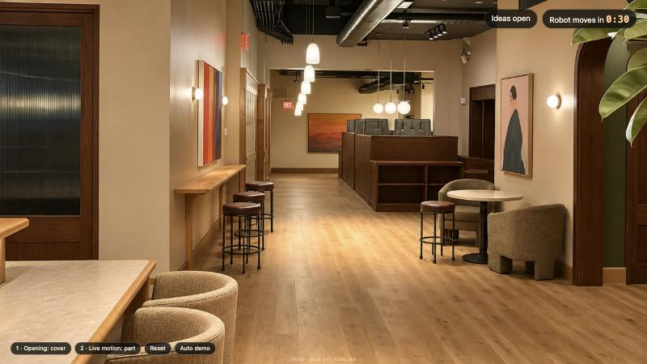
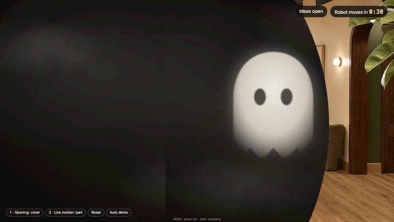
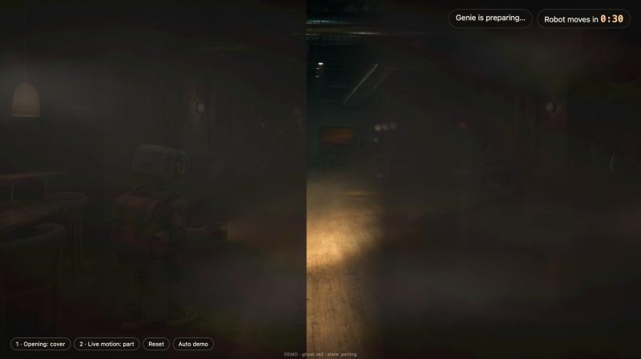
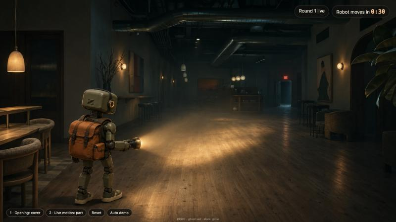

# Ghost veil for the audience opening

Art direction: Crowd. Timing and the native stream: World. The veil replaces the photo-to-render dissolve, which exposed the inserted sprite.

| 1 Venue photo | 2 Apparition sweeps over the lens | 3 Full coverage, breathing (Genie preparing) | 4 Parts once live motion arrives | 5 Live |
|---|---|---|---|---|
|  |  |  |  |  |

## Plug it in (World's stage)

Crowd serves the module at `/veil/ghost-veil.js` (and its `veil-machine.js`) from the same host. It has no dependencies and adds one fixed full-screen element.

```js
import { createGhostVeil } from "/veil/ghost-veil.js";
const veil = createGhostVeil(document.body, { zIndex: 5 }); // put it under your HUD and Crowd's /overlay

// Opening starts (show the venue photo first, as now):
await veil.cover();   // ~1.9 s sweep; resolves when the screen is fully covered
// Swap the canvas to the prepared hall / live feed while covered. Nothing behind the veil shows.
// The veil keeps breathing for as long as Genie takes to prepare.

// Only when the live feed itself has motion:
await veil.part();    // ~1.5 s curtain; resolves when it's gone
```

- **Never half-open:** `part()` called during the sweep waits until coverage is complete, then parts. Timers back up the CSS animation events, so a background tab (where browsers pause animations) still reaches full coverage and still parts.
- **Reduced motion** (`prefers-reduced-motion: reduce`, or `{ reducedMotion: true }`): a still, opaque veil with 0.25 s and 0.35 s fades. No apparition, no drift.
- **HUD and overlay stay readable:** keep the veil's `zIndex` below the HUD and the `/overlay` iframe, so people can join and submit while Genie loads.
- **No extra copy:** the veil has no text. The phase line ("Genie is preparing…") stays in your HUD.
- Next round: call `cover()` again.

Demo: `pnpm dev` in `apps/crowd`, then open `/dev/docs/veil-demo.html` (`?auto` runs the whole sequence with a slow 5 s prepare; `?still` shows the reduced-motion version). State rules are tested in `test/veil.test.ts`.
