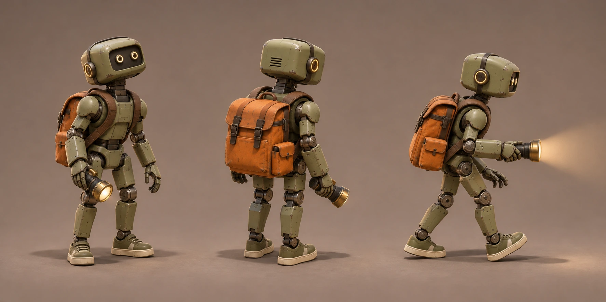
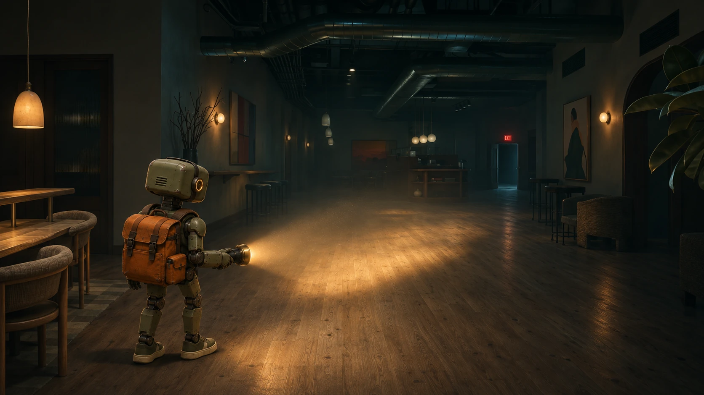

# The hallway robot

A knee-high explorer stops when it hears something, raises its flashlight to look, then takes a careful step. Its bravery is choosing to keep going.

## Recognize it from behind

The shell is scuffed sage enamel. The rounded box head has two warm ring eyes, black vents and a round side fitting. The burnt-orange backpack has two dark vertical straps. Its thin jointed legs end in cream-soled boots. A short black flashlight with a brass rim stays in its **right hand**. The beam lands where it looks. Use the turnaround for the stage, thumbnails, seeds and new rooms.

## Start the hallway

Use the bundled [Genie seed](hallway-seed.jpg) at the start of a round. The seed is an adaptation of the venue photo with the character from the turnaround. Reuse this file for repeat hallway runs. For another room, compose a new seed from that room’s photo and this same turnaround. Keep the seed with its replay so the team can reproduce the opening.

Place the camera above and behind the right shoulder. The robot occupies the lower-left part of the shot. Its right hand, flashlight, boots and the walkable strip stay visible together. Let the pendants fall dim and cool after closing time. The warm torch picks out hazards on the floor. Keep the doorway legible on a projector.

## Give the audience time to read a haunting

Place a chair several robot strides ahead, inside the beam, with a visible way around one side. Give the audience time to see the change before the robot reaches it. Keep props away from the robot’s feet during placement.

Courtney’s audience view shows the goal and time remaining. When a haunting happens, show the activity, then the observed response, for example “Chair in the aisle” followed by “Robot steps right.” Only confirm that the chair appeared after it is visible. Keep those captions and the ghost cue off Sri’s Player-view frames.

## Play one continuous round

The round owner creates one Genie interaction, stores its ID, and seeds it once. Moves, pauses, hauntings and camera updates all use that interaction. A spectator refresh reconnects to the current round. Recognize the robot’s win when its feet cross the signed exit threshold. If time expires first, the audience wins. An interrupted stream is an interrupted round and carries no winner.

The two-move and chair recordings are short live experiments. A fresh seed fixes the initial design; review the flashlight hand, backpack and camera position for drift during play.
